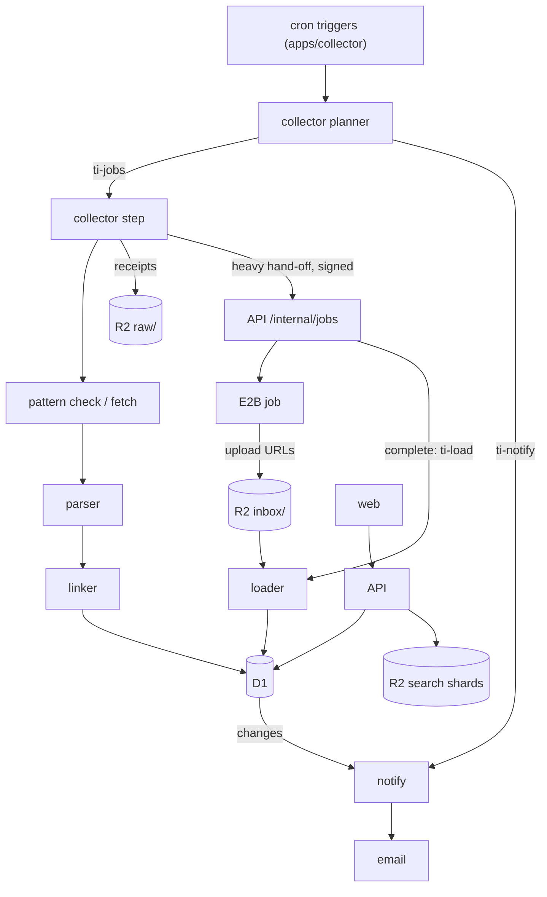

# Architecture

A one-page map of how Threat Index fits together. The full design is in
[the implementation plan](IMPLEMENTATION_PLAN.md); the reasons behind the big choices are in the
[decision records](decisions/).

## Apps and packages

| Path                | Owns                                                                                                                  |
| ------------------- | --------------------------------------------------------------------------------------------------------------------- |
| `apps/collector`    | Cron planner, the `ti-jobs` queue consumer (`step.ts`), receipts, the watchdog, and the signed hand-off of heavy jobs |
| `apps/loader`       | Consumes the `ti-load` queue and moves E2B output from R2 into D1 within the daily write budget                       |
| `apps/notify`       | Consumes the `ti-notify` queue, matches changes to watchlists, and sends alert and digest email                       |
| `apps/api`          | Hono JSON API: entries, search, accounts, webhooks, and the signed `/internal/jobs` routes                            |
| `apps/web`          | React Router server-rendered web app; it reads everything through the API service binding                             |
| `packages/core`     | Types, ID normalisation, licence gates, the budget meter, request signing, R2 key layout                              |
| `packages/sources`  | The source registry: one file per source in `src/sources/`                                                            |
| `packages/patterns` | The seven pull patterns: `git`, `changelist`, `since`, `fingerprint`, `feed`, `page`, `heavy`                         |
| `packages/parsers`  | One parser per data format, found by file name (`loadParser`)                                                         |
| `packages/linker`   | Alias graph, hot-set rule, change log, company matching                                                               |
| `packages/db`       | SQL migrations for the six D1 databases                                                                               |
| `e2b/`              | The sandbox template and the heavy jobs it runs                                                                       |

## Data flow

What each arrow rests on:

- **cron → planner → step:** the `crons` in `apps/collector/wrangler.jsonc`, `scheduled()` in
  `apps/collector/src/index.ts`, and `env.JOBS.sendBatch` in `planner.ts`. The planner picks the sources whose
  cadence matches the cron (`CADENCE_BY_CRON` in `planner.ts`).
- **step → pattern → parser → linker → D1:** `runStep` in `apps/collector/src/step.ts` (`patternFor`,
  `loadParser`, `link`, `writeRows`).
- **step → R2 `raw/`:** `writeReceipt` in `apps/collector/src/receipt.ts`; the key layout is in
  `packages/core/src/r2-keys.ts`.
- **step → API → E2B → R2 → loader → D1:** `startHeavyJob` in `apps/collector/src/heavy.ts` posts to
  `/internal/jobs`, signed with a shared secret. The routes in `apps/api/src/routes/internal-jobs.ts` start the
  job, hand out upload URLs, and on `complete` send `ti-load` messages. `apps/loader` consumes `ti-load`.
- **planner → notify → email:** the collector sends a `ti-notify` message after the three-hourly run
  (`planner.ts`); `apps/notify/src/consume.ts` reads the change log from D1 and sends mail.
- **web → API → D1 and R2:** the `API` service binding in `apps/web/wrangler.jsonc`; search reads R2 shards in
  `apps/api/src/lib/search-engine.ts` ([ADR 0004](decisions/0004-search-shards-instead-of-fts.md)).

Notes:

- Licence gates run in the collector (what is ingested) and in the API (what is shown), never only in the UI.
  See `packages/core/src/licence.ts`.
- The queue, bucket and database names above are looked up by name from each app's `wrangler.jsonc`; account
  specific values are `${VAR}` placeholders filled by `scripts/wrangler-config.mjs`.
